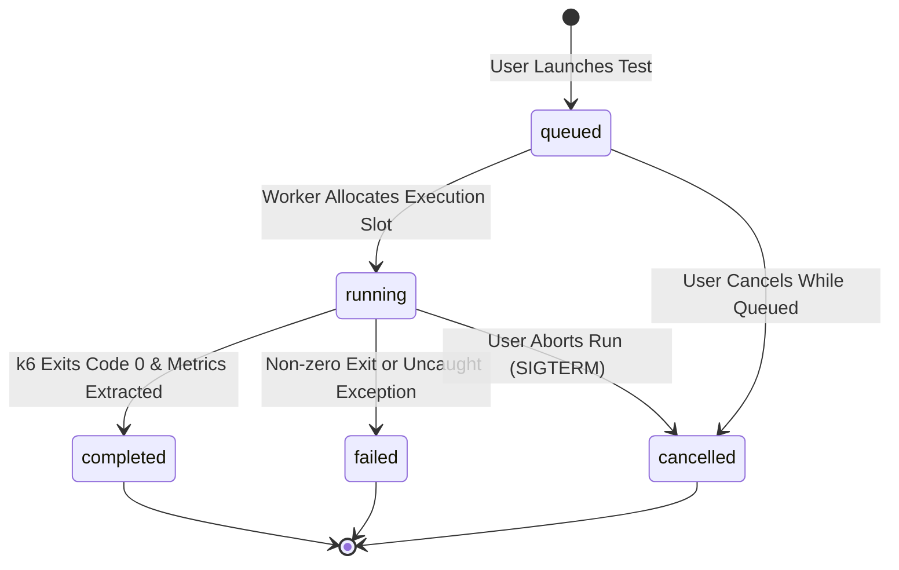

# APIForge — System Architecture

## 1. High-Level Architecture Overview

APIForge is built as a **modular monolith** with a dedicated **load-testing child worker process**. 

The design intentionally avoids premature microservices, message queues, and Kubernetes overhead while preserving strict separation of concerns, high maintainability, and clear boundaries between management APIs, test execution, and user interfaces.

```mermaid
flowchart TD
    User["Developer / User Browser"]
    
    subgraph Frontend ["Client Layer (React 18 + Vite)"]
        UI["Pages & Components (Tailwind CSS)"]
        State["Feature State & Hooks"]
        APIClient["Axios Centralized API Client"]
    end
    
    subgraph Backend ["Server Layer (Express.js Modular Monolith)"]
        Middleware["Security & Auth Middleware (Helmet, CORS, JWT, Rate Limiter)"]
        Controllers["Module Controllers"]
        Validation["Zod Request Validation"]
        Services["Business Services (Auth, Target, TestRun, Results)"]
        DB["MongoDB (Mongoose ODM)"]
    end
    
    subgraph Engine ["Load Testing Worker Layer"]
        ProcessMgr["Process Manager (Node.js spawn)"]
        ScriptGen["k6 Script Generator"]
        Parser["k6 Summary Metrics Parser"]
        k6Process["k6 CLI Child Process"]
    end
    
    subgraph Demo ["Demo Sandbox (Isolated)"]
        DemoAPI["Built-in Demo Endpoints (:5001)"]
    end
    
    User -->|HTTP / SPA| UI
    UI --> State
    State --> APIClient
    APIClient -->|REST API Requests (:5000)| Middleware
    Middleware --> Validation
    Validation --> Controllers
    Controllers --> Services
    Services --> DB
    
    Services -->|Trigger Test| ProcessMgr
    ProcessMgr --> ScriptGen
    ScriptGen --> k6Process
    k6Process -->|Synthetic Traffic| DemoAPI
    k6Process -->|Live stdout/stderr| ProcessMgr
    k6Process -->|JSON Summary Output| Parser
    Parser -->|Normalized Metrics| Services
```

---

## 2. Layer Responsibilities

### Backend (Server)
- **`src/config/`**: Centralized environment variable validation (`env.js`) via Zod and database connection lifecycle (`database.js`).
- **`src/middleware/`**: Cross-cutting concerns including JWT authentication (`authenticate.js`), request validation (`validateRequest.js`), rate limiting, 404 handling, and centralized error serialization.
- **`src/modules/`**: Domain-specific feature modules:
  - `auth/`: User registration, authentication, token issuance, password security.
  - `targets/`: Target URL configuration, SSRF security validation, target health checking.
  - `tests/`: Test configuration, lifecycle state transitions (`queued` → `running` → `completed` / `failed` / `cancelled`).
  - `results/`: Metric calculation, aggregation, distribution curves, and CSV/JSON exports.
  - `demo/`: Isolated demo service with simulated latencies, status codes, and rate limiting.
- **`src/load-testing/`**:
  - `scriptBuilder.js`: Compiles validated target & workload parameters into safe, non-executable k6 JavaScript configurations.
  - `k6Runner.js`: Controls execution via Node.js `spawn` with argument arrays (preventing shell injection).
  - `processManager.js`: Tracks active child process PIDs, enforces concurrency caps, and manages graceful terminations.
  - `summaryParser.js`: Parses k6 JSON summaries into normalized performance structures.

### Frontend (Client)
- **`src/components/ui/`**: Atomic components (Button, Input, Card, Badge, Modal, Skeleton).
- **`src/components/layout/`**: AppHeader, Sidebar, Container, DashboardShell.
- **`src/features/`**: Domain-specific UI flows (`auth`, `dashboard`, `targets`, `test-runs`, `results`, `history`).
- **`src/services/`**: Centralized Axios client (`apiClient.js`) handling base URLs, authentication headers, and uniform error extraction.

---

## 3. Load-Test Lifecycle & State Machine



### Invariants:
1. Terminal states (`completed`, `failed`, `cancelled`) are immutable. A cancelled test cannot be overwritten by a late worker process event.
2. The server strictly enforces limits on virtual users (default max 500) and duration (default max 300s) to safeguard resources.
3. Tests run in separate child processes so k6 execution never blocks the Express Node.js event loop.
