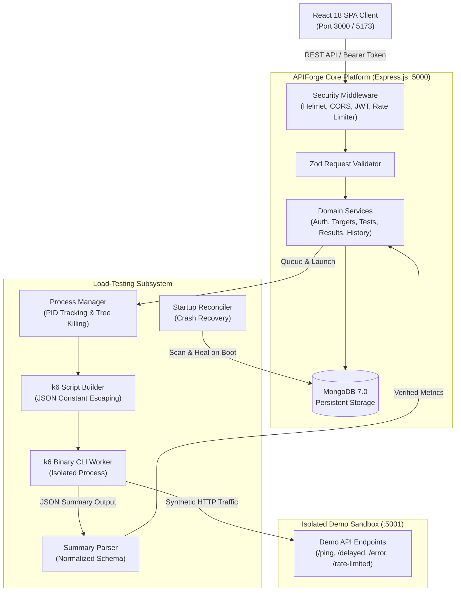

# APIForge — Capstone Presentation & Viva Defense Guide

This guide is designed for project demonstrations, evaluator reviews, and viva examinations for the APIForge Capstone Project.

---

## 🎯 1. Elevator Pitch & Problem Statement

### The Problem
Performance testing is essential for modern cloud APIs, yet existing tooling suffers from notable drawbacks:
- **Legacy GUI tools (e.g. Apache JMeter)**: Heavyweight Java runtimes, XML-based configurations, steep learning curves, and outdated reporting.
- **CLI tools (e.g. raw k6, wrk, ab)**: Fast and developer-friendly, but lack visual management, persistence, comparative analytics, and multi-tenant accessibility for team members.
- **Commercial SaaS platforms (e.g. k6 Cloud, BlazeMeter)**: Prohibitively expensive for students, startups, and self-hosted internal infrastructure.

### The APIForge Solution
APIForge bridges the gap between raw CLI load-testing efficiency and rich visual web interfaces:
1. **Real k6 Execution**: Spawns authentic k6 child processes and parses real JSON summary output. **Zero metrics are fabricated.**
2. **Multi-Stage Workload Profiles**: Constant, Ramping, Spike, and Stress test curves with SLA threshold evaluation.
3. **Comparative Analysis & Trends**: Side-by-side test deltas and historical performance trajectories over time.
4. **Hardened Multi-Tenant Security**: Multi-layer SSRF filter, BOLA/IDOR tenant isolation, process tree cleanup, and automated secret header redaction.
5. **Turnkey Deployment**: Available via local Node.js or multi-container Docker Compose.

---

## 🏛️ 2. Architectural Blueprint

---

## 🎬 3. Live Demonstration Script (Step-by-Step)

Follow this sequence during an evaluation or presentation:

| Step | Action | Key Talking Points |
|---|---|---|
| **1. Auth & Shell** | Log in or register an account. | Point out JWT Bearer auth, bcrypt password hashing, and clean developer dark UI. |
| **2. Target Registration** | Navigate to **API Targets** $\to$ click **Add Target** $\to$ register `http://localhost:5001`. | Explain pre-flight multi-layer SSRF check (blocks loopback unless whitelisted Demo port, blocks cloud metadata and RFC 1918 private IPs). |
| **3. Target Health Probe** | Click **Check Health** on the target card. | Demonstrates live HTTP probe measuring actual roundtrip latency and status code. |
| **4. Test Configuration** | Navigate to **Load Tests** $\to$ click **New Load Test**. Use Quick Fill for Demo API. | Highlight **Workload Profiles** (Ramping, Spike, Stress), VUs slider (max 50 safety cap), duration, and SLA Thresholds ($p95 < 200\text{ms}$). |
| **5. Live Execution** | Click **Start Test**. | Shows real-time status transitions (`queued` $\to$ `running`), live progress percentage, and non-blocking background worker execution. |
| **6. Results Dashboard** | Inspect completed test results. | Showcase Recharts visualizations: Percentiles breakdown bar chart, HTTP status code donut, throughput timeline, and SLA threshold pass/fail verdict. |
| **7. Multi-Format Exports** | Click **Export** $\to$ select **HTML**, **CSV**, and **JSON**. | Emphasize automated secret header masking (`[REDACTED]`) and self-contained print/PDF-ready HTML report. |
| **8. Comparative Analysis** | Navigate to **Compare** $\to$ select two completed runs. | Demonstrates directional metric deltas (green improvements vs. red regressions), compatibility rating (`HIGH`/`MODERATE`), and textual summary. |
| **9. Historical Trends** | View **Dashboard** $\to$ **Historical Performance Trends**. | Shows multi-series progression chart tracking Throughput, Avg Latency, and p95 Latency over builds. |

---

## 💡 4. Top 10 Viva / Examiner Questions & Authoritative Answers

### Q1: Why did you choose k6 instead of Apache JMeter or Postman Runner?
> **Answer**: k6 is written in Go, which provides superior concurrency and low memory footprint compared to JVM-based JMeter threads. Unlike Postman Runner (which runs sequentially on a single JavaScript event loop), k6 allocates true concurrent virtual users with microsecond-level timing accuracy. In APIForge, we orchestrate k6 programmatically and normalize its output into structured MongoDB records.

### Q2: How do you guarantee that load test metrics are not fabricated?
> **Answer**: All test results originate directly from k6's machine-readable JSON summary (`--summary-export`). The summary parser (`summaryParser.js`) extracts actual counts (`http_reqs`), percentiles (`http_req_duration`), and failure counters. If a target is unreachable or k6 exits non-zero, the run is marked `FAILED` with category `TARGET_UNREACHABLE` or `EXECUTION_ERROR`.

### Q3: How does APIForge protect against Server-Side Request Forgery (SSRF)?
> **Answer**: We implement a 5-layer SSRF filter (`ssrfFilter.js`):
> 1. Protocol check: Permits strictly `http:` and `https:`.
> 2. Hostname check: Blocks `localhost`, `127.0.0.1`, `[::1]`, and internal hostnames.
> 3. Cloud metadata check: Specifically blocks `169.254.169.254` (AWS/GCP/Azure instance metadata service).
> 4. DNS resolution: Resolves hostnames to IP addresses before request initiation to prevent DNS rebinding attacks.
> 5. RFC 1918 private IP check: Blocks `10.0.0.0/8`, `172.16.0.0/12`, and `192.168.0.0/16`.
> The only exception is the explicitly whitelisted developer sandbox port (`5001`).

### Q4: What prevents users from accessing or modifying another user's test runs (BOLA/IDOR)?
> **Answer**: Every document in the `targets` and `testruns` MongoDB collections contains an immutable `owner` ObjectId reference. Every backend service query strictly filters by `{ _id: id, owner: req.user._id }`. If User B attempts to view, start, cancel, rerun, or export User A's test run, the API returns `404 Not Found` or `403 Forbidden`.

### Q5: What happens if the server crashes or restarts while a load test is running?
> **Answer**: We implemented a startup crash reconciler (`reconciler.js`). On server boot, `reconcileInterruptedRuns()` queries the database for any tests left in `running` or `queued` state. Because their child processes are dead, it gracefully transitions them to `FAILED` with error category `INTERNAL_ERROR` and an explanation ("Server was restarted while this test run was in progress"). This prevents orphaned zombie states.

### Q6: How do you handle process termination cleanly across Windows and Linux?
> **Answer**: In Node.js, `child.kill('SIGTERM')` on Windows does not terminate the child process tree, leaving orphaned background processes. In `processManager.js`, we detect the host platform: on Windows, we execute `taskkill /pid <PID> /T /F` to terminate the entire process tree; on POSIX systems, we send `SIGTERM` followed by a grace-period `SIGKILL`.

### Q7: How do you prevent script injection when compiling k6 test scripts?
> **Answer**: User-supplied values (target URL, endpoint, HTTP headers, request body) are never concatenated into the k6 script string as raw code. In `scriptBuilder.js`, every variable is serialized into JSON string constants using `JSON.stringify()`. Quotes, backslashes, and template literal `${...}` expressions are automatically escaped into inert literal strings.

### Q8: Why is the Demo API hosted on port 5001 instead of on the main port 5000?
> **Answer**: Running load tests against the same port hosting the management dashboard could cause self-inflicted Denial of Service (DoS), exhausting the Express thread pool and skewing latency measurements. Hosting the Demo API on a dedicated secondary HTTP server (`:5001`) isolates management traffic from synthetic load traffic.

### Q9: How are sensitive credentials protected in test configurations and exports?
> **Answer**: User passwords use bcrypt hashing with salted rounds and are excluded by default (`select: false`). Headers containing sensitive tokens (`Authorization`, `X-Api-Key`, `Cookie`, `isSecret: true`) are unmasked only in the secure backend execution context. When returning test runs, history, or exports to the client, `redactSensitiveHeaders` replaces sensitive values with `[REDACTED]`.

### Q10: What are the current limitations of the project?
> **Answer**: We document limitations honestly:
> 1. Single-node runner: Workers execute on the host container, not across a distributed cluster of distributed worker nodes.
> 2. Safety bounds: Concurrency is capped at 50 virtual users and 300 seconds to protect local hardware.
> 3. HTTP protocols only: Supports HTTP/1.1 and HTTP/2 endpoints; does not currently test WebSockets or gRPC streams.

---

## 📊 5. Quality & Test Verification Summary

- **Total Test Files**: 38 test suites across backend and frontend.
- **Total Automated Tests**: 275 tests passing with 100% pass rate.
- **ESLint Code Quality**: 0 errors, 0 warnings across all JavaScript and JSX files.
- **Containerization**: Verified multi-container deployment via Docker Compose.
